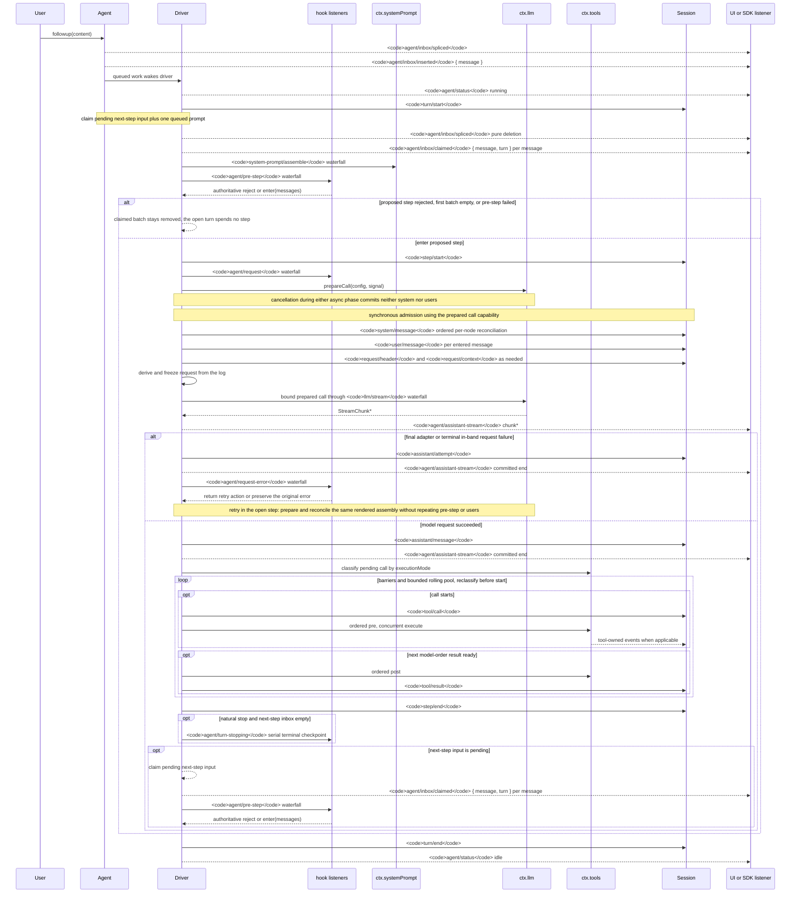

<!-- Generated by scripts/gen-doc-graphs.ts - do not edit by hand.
     Run `pnpm run gen-doc-graphs` to regenerate. -->

# エージェントのターンとステップのライフサイクル

日本語 | [English](agent-lifecycle.en.md) | [中文](agent-lifecycle.zh.md)
このシーケンスは [architecture.md](architecture.md#turn-flow) の視覚的な補足である。永続的なリプレイ事実は `session/event` に、ライブの制御と状態は `agent/*` に置く。

`assistant/message` イベントは、内容空や `max-tokens` 終了を含むすべての成功したプロバイダー呼び出しを記録し、正確なコンパクトな時系列ストリームを埋め込む。空の内容は派生履歴から除外される。ライブの `agent/assistant-stream` チャンクフレームは一時的である。リプレイはどちらかの永続的な決着を読み、決着前のハードなプロセス喪失は永続的な試行ストリームを残さない。

`dsh-compaction-basic` は要求導出前の圧力に `agent/pre-step` を使い、正規のコンテキストオーバーフローにのみ `agent/request-error` を使う。いずれかのトリガーが成立すると、要約選択の前に任意のツール結果枝刈りが実行される。回復は開いているステップ内で実行され、枝刈りまたは要約がサーフェス置換世代を進めた場合にのみ再試行する。そうでない場合は元の要求エラーが権威のままである。各再試行は要求導出の前に呼び出しを準備し、保持されたレンダー済みアセンブリーを整合させる。組み立て、pre-step、ユーザー受付の繰り返しはない。

返された `agent/pre-step` 決定は権威である。`next()` をラップするリスナーは、置換が意図的でない限り下流メッセージと `startsRequestSeries` を保持する。ステアリングと注入コンテキストは、後のクレーム操作が次ステップバッチを取得した後に同じウォーターフォールを通過する。

リプレイ可能なトランスクリプトデータが必要な SDK ユーザーは `session/event` を消費すべきである。`agent/*` はキュー・状態、プロンプトインターセプト、要求構築、ステアリング、継続、エラーのためのライブ調整 API である。

メンテナンスモード: 厳選された Mermaid シーケンス。正確なイベントシグネチャは生成された Cordis カタログにある。
