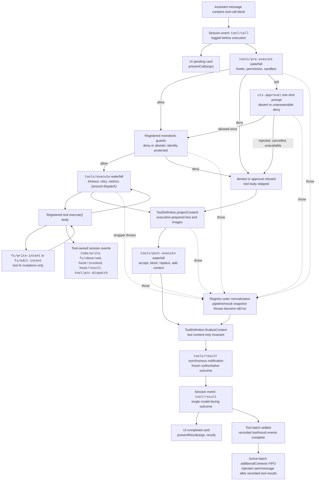

<!-- Generated by scripts/gen-doc-graphs.ts - do not edit by hand.
     Run `pnpm run gen-doc-graphs` to regenerate. -->

# ツール実行パイプライン

日本語 | [English](tool-execution-pipeline.en.md) | [中文](tool-execution-pipeline.zh.md)
このグラフは、ループを変えずに方針・フック・サンドボックス化・ファイルシステムガード・結果書き換え・最終結果観測・UI 描画が動作する位置を示す。`tools/pre-execute` ウォーターフォールが最初に動作し、単調ガードが次に動作し、`tools/execute` と `tools/post-execute` ウォーターフォールが続く。3 ウォーターフォールは呼び出しを変換できる。定義所有の `projectContent` は post-execute の前に準備済み内容を設置し、`finalizeContent` と `tools/result` はその後に動作する。

`tool-fs` 上の `fs/*` イベントでは、ファイルシステムの読み取り先行編集検査はその下に留まる。汎用 pre/post ウォーターフォールはフックと承認方針を載せ、`ctx.approval` は単調ガードの前に問い掛けを解決し、並び替えられてはならない所有者方針は登録済みガードのままである。タイムアウトなどの around 配送関心事は `tools/execute` を包む。レジストリは候補結果を無損失スナップショットし、可視定義のスナップショット済み `finalizeContent` 受け付けが同期的内容限定不変条件を強制する前にスナップショット失敗を正規化する。`tools/result` は次に不変の無損失 JSON 結果を観測する。これによりフックはツールを 1 方針サービスに結合せずにツール族をまたげる。PTC 方式は予約 `run_code` 輸送とその直列化 sub 呼び出しの両方をパイプラインに送る。sub 呼び出しは親トークンを運び、`tool/ptc-dispatch` を記録し、拒否を束縛拒否として返し、呼び出し・結果隣接を保つため `additionalContexts` を省く。

保守方式:厳選 Mermaid 流れ。正確なツールスキーマとイベント署名は生成カタログにある。
