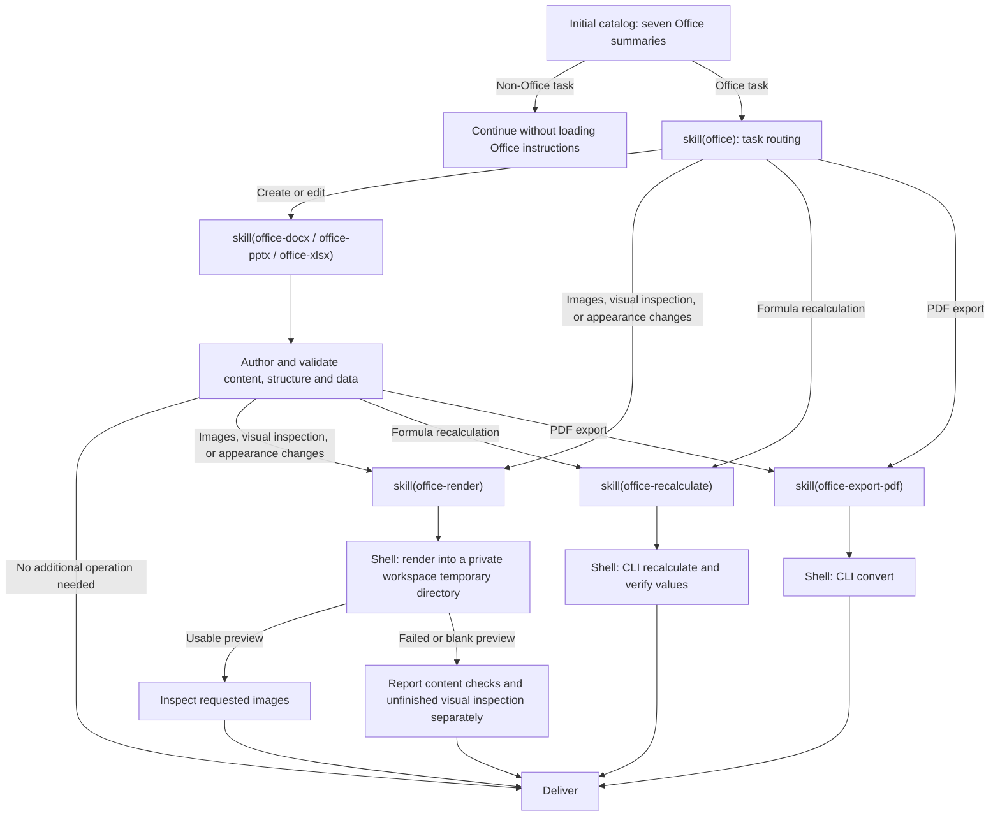

# @deepseek-ai/dsh-skill-office

日本語 | [English](README.en.md) | [中文](README.zh.md)

## 概要

カタログは Office ルーターと 6 件の作成または操作スキルを一覧する。完全な指示は要求時に読み込む。作成スキルは選択 Python ライブラリを使い、操作スキルは設定済み Node と LibreOffice Kit CLI パスを提供する。SDK と Desktop はスキルプロバイダーと依存関係照会を別々にマウントする。

## 目次

- [このパッケージを使う](#use-this-package)
  - [漸進読み込み](#progressive-loading)
- [実装を理解する](#understand-the-implementation)
- [さらに調べる](#further-exploration)
- [モデル体験](#model-experience)
- [既知の制限と deferred work](#known-limitations-and-deferred-work)
- [開発メモ](#dev-note)

-----

<a id="use-this-package"></a>
## このパッケージを使う

スキルレジストリと `dsh-tool-skill` のそばにスキルプロバイダーをマウントする。プロバイダーはスキル指示を提供し、操作スキルは読み込み時に絶対インタープリターと CLI パスを追記する。

```yaml
- name: '@deepseek-ai/dsh-skill-office'

```

| フィールド | 既定値 | 意味 |
|---|---|---|
| `assetRoot` | 運び手リソースまたはパッケージ済み `assets/` | 7 件のスキルフォルダーを含む絶対ディレクトリ。 |
| `node` | ホスト Node.js | 操作スキル用のスタンドアロン Node 実行可能ファイル。パッケージ済み運び手は明示的に提供する。 |
| `cli` | インストール済み Kit CLI | 絶対 CLI 入口。`false` は操作実行を無効化する。 |

無効なスキル資産は登録を拒否する。作成指示は描画器パスを解決しない。操作指示の読み込みはエンジンを準備せずに既存インタープリターと CLI ファイルを検証する。承認・サンドボックス化・キャンセル・出力管理は Bash または PowerShell が所有する。リソースと実行ツールは同一ホストを指さなければならない。

<a id="progressive-loading"></a>
### 漸進読み込み

モデルは課題からスキルを選ぶ。ホストはファイル拡張子に基づいて完全な指示を注入しない。7 件すべてのスキルは `skill` または明示ユーザー呼び出し経由で名前指定により一覧・読み込み可能である。表計算セル塗りや文字配置を含む要求された外観変更は、明示の外観検査要求がなくても描画を要求する。描画省略の明示要求は優先する。純粋操作は対応スキルに直接入れる。



新規ファイルと内容・データ・数式編集は、付随する基本書式を含むことのみを理由に描画を要求しない。preview 画像はワークスペース内のプライベートなランダム名一時ディレクトリを使い、検査後に除去する。応答はそれらにリンクせずに検査を文で報告する。PDF 出力は PDF リーダーを探さずにコマンド結果と `%PDF-` 署名を検証する。読み込み済み指示は操作完了後もセッション履歴に残る。図は対応クライアント間の通常 preset を記述する。minimal や sdk-minimal のシェル専用定義を変更しない。

-----

<a id="understand-the-implementation"></a>
## 実装を理解する

<details>
<summary>実装内部 — クリックして展開</summary>

プロバイダーは登録時に説明を読み、本体は要求時に読む。レジストリ優先順位・スコープ・呼び出し許可はすべてのスキルに適用される。読み込み済み各スキルは相対参照用にそのリソースディレクトリを含む。破棄はすべての候補の登録を外す。

プロバイダーはツールや有効化プロジェクションを登録しない。読み込み済みスキル結果は汎用スキルローダーを通じてログ化されたまま残る。PTC プログラムでは完全な `tools.skill(...)` 結果を表示または返却し、その指示がモデルに届くようにする。再開と fork は既存セッション履歴とツール宣言調停を使う。インタープリターと CLI パスは操作スキル読み込み時にのみ解決される。

| ファイル | 責任 |
|---|---|
| [`src/index.ts`](src/index.ts) | リソース登録と不変スキル本体。 |

| [`assets/`](assets/) | ルーターと 6 件の subskill。 |

</details>

-----

<a id="further-exploration"></a>
## さらに調べる

- [スキルレジストリ](../skill/README.md) — 検出と優先順位。
- [スキルツール](../tool-skill/README.md) — モデルカタログと読み込み済み本体。
- [ファイル配送](../../deliverables/tool-present/README.md) — 現行ソースパス配送。

-----

<a id="model-experience"></a>
## モデル体験

間接的に、`dsh-tool-skill` を通じて。同ツールは初期 Office 要約を描画し、`skill(name)` から routing または選択 subskill 指示を返す。

#### KV キャッシュ効果

スキル結果はツール宣言を変えずに履歴に追記され、読み込み済み文や画像は操作完了後も残る。文字推定は `ceil(characters / 4)` を使う。要約は最大 50 トークン、ルーター本体は最大 200 であり、作成本体は作成と操作 guide 合計より少なくとも 35% 小さい。スキルラッパー・汎用カタログ・シェル宣言・`load_workspace_dependencies` は別の費用であり、これらの推定はサーバー使用量ではない。

## 既知の制限と deferred work

<a id="known-limitations-and-deferred-work"></a>

- プロバイダーは作成ライブラリを install しない。
- LibreOffice 出力はネイティブ Office アプリケーションと異なり得る。
- 旧式・暗号化・マクロ有効ファイルは適切な別のワークフローを必要とする。

<a id="dev-note"></a>
### 開発メモ

<details>
<summary>メンテナー向け作業コンテキスト — クリックして展開</summary>

なし。

</details>
